# SIMPLE DOCKER
***
## Part 1. Готовый докер
### 1.1 Взять официальный докер образ с nginx и выкачать его при помощи `docker pull`


Но в самом начале работы меня настигла вот такая напоминалочка от авторов `sudo` (поскольку впервые на этой машине работаю от пользователя user=`felisasi`):

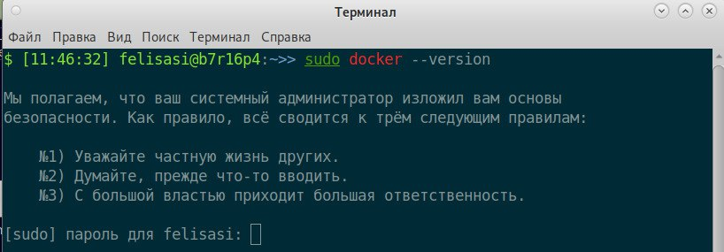

*Рисунок 1.0 - Выполнение команды `sudo docker --version`*

Ну чтож, примим к сведению и продолжим путь:

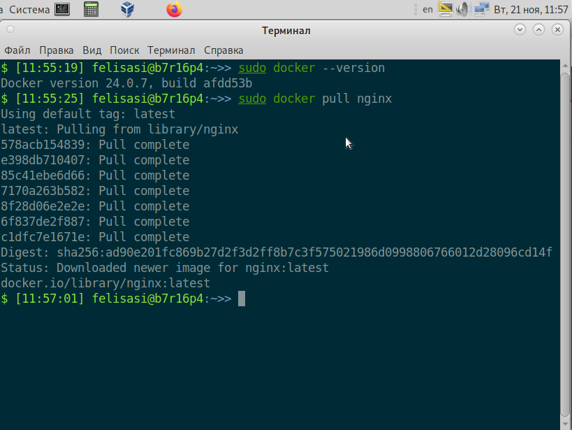

*Рисунок 1.1 - Выполнение команды `sudo docker pull nginx`*

>___Примечание:__\
 После выполнения данной команды терминал может вывести сообщение о том, что docker не установлен. Чтобы установить docker, выполните команду\
`sudo apt-get install docker-ce` или \
`curl -sSL https://get.docker.com/ | sudo sh`._

### 1.2 Проверить наличие докер образа через `docker images`

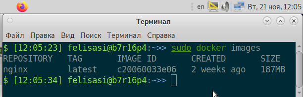

*Рисунок 1.2 - Выполнение команды `sudo docker images`*

### 1.3 Запустить докер образ через `docker run -d [image_id|repository]`

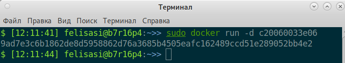

*Рисунок 1.3 - Выполнение команды `sudo docker run -d c20060033e06`*

### 1.4 Проверить, что образ запустился через `docker ps`

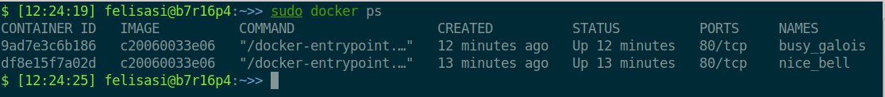

*Рисунок 1.4 - Выполнение команды `sudo docker ps`*

>__Примечание:__\
>Если выполнить команду `docker run -d [image_id|repository]`, то запустится два экземпляра одного образа.\
>Однако совсем не обязательно делать два, как в данном случае, достаточно одного.\
>Далее я продолжу работу со вторым запущенным экземпляром контейнера __`9ad7e3c6b186`__.

### 1.5 Посмотреть информацию о контейнере через `docker inspect [container_id|container_name]`

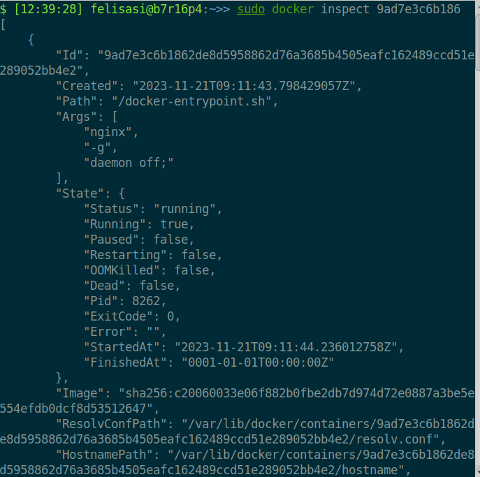

*Рисунок 1.5 - Выполнение команды `sudo docker inspect 9ad7e3c6b186`*

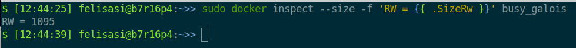

*Рисунок 1.6 - Размер контейнера после выполнения команды `sudo docker inspect --size -f 'RW = {{ .SizeRw }}' busy_galois`*

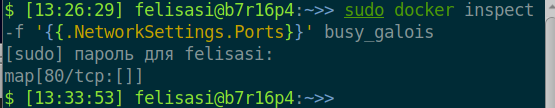

*Рисунок 1.7 - Список замапленных портов `sudo docker inspect -f '{{.NetworkSettings.Ports}}' busy_galois`. Как мы видим, порт 80 не замаплен*

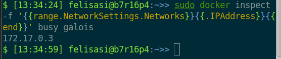

*Рисунок 1.8 - IP контейнера после выполнения команды `sudo docker inspect -f '{{range.NetworkSettings.Networks}}{{.IPAddress}}{{end}}' busy_galois`*

### 1.6 Остановить докер образ через `sudo docker stop [container_id|container_name]`

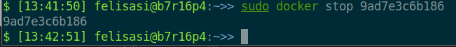

*Рисунок 1.9 - Выполнение команды `sudo docker stop 9ad7e3c6b186`*

### 1.7 Проверить, что образ `9ad7e3c6b186` остановился через `docker ps`

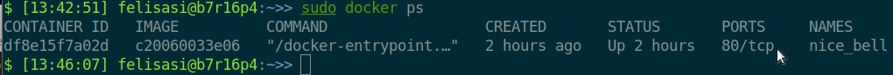

*Рисунок 1.10 - Выполнение команды `sudo docker ps`*

Остоновим первый образ `df8e15f7a02d` и проверим, что больше запущенныз оброзов нет.

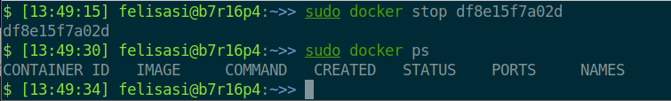

*Рисунок 1.10.1 - Выполнение команд `sudo docker stop df8e15f7a02d` и `sudo docker ps`*


### 1.8 Запустить докер с портами 80 и 443 в контейнере, замапленными на такие же порты на локальной машине, через команду `run`

Для начала узнаем id докер-образа с помощью команды `sudo docker images`

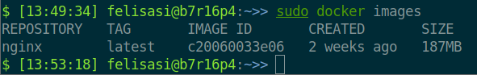

*Рисунок 1.11 - Выполнение команды `sudo docker images`*

Затем выполним команду `sudo docker run -d -p 80:80 -p 443:443 c20060033e06` для запуска докера с портами 80 и 443 в контейнере

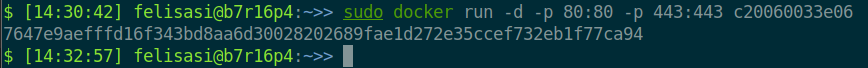

*Рисунок 1.12 - Выполнение команды `sudo docker run -d -p 80:80 -p 443:443 c20060033e06`*

### 1.9 Проверить, что в браузере по адресу localhost:80 доступна стартовая страница nginx

Открываем браузер, например, Mozilla Firefox. Далее в поисковой строке набираем `localhost:80` и нажимаем Enter.

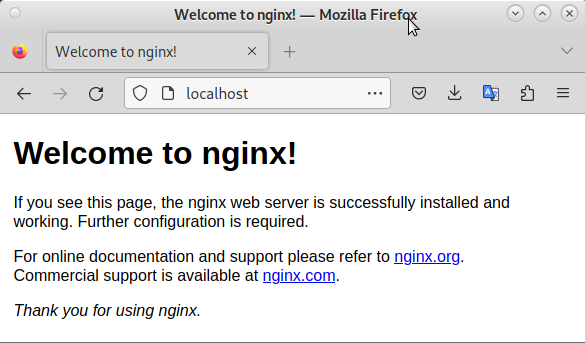

*Рисунок 1.13 - Стартовая страница nginx*

### 1.10 Перезапустить докер контейнер через `docker restart [container_id|container_name]`

Для начала узнаем id контейнера через команду `sudo docker ps`

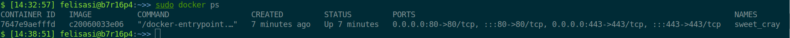

*Рисунок 1.14 - Выполнение команды `sudo docker ps`*

Затем выполняем команду `sudo docker restart 7647e9aefffd`

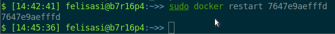

*Рисунок 1.15 - Выполнение команды `sudo docker restart 7647e9aefffd`*

Теперь проверим, что наш контейнер запустился. Выполним команду `sudo docker ps`

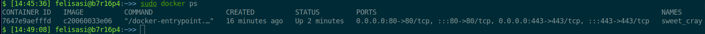

*Рисунок 1.16 - Выполнение команды `sudo docker ps`*

***
## Part 2. Операции с контейнером

### 2.1 Прочитать конфигурационный файл nginx.conf внутри докер контейнера через команду `exec`

Немного информации про файл nginx.conf.

>Файл __nginx.conf__ - это конфигурационный файл для сервера Nginx. Он определяет параметры и настройки, необходимые для работы сервера, включая виртуальные хосты, прокси, настройки безопасности, кеширование, SSL-сертификаты и другие параметры. Вот примерный обзор того, что файл nginx.conf может содержать:

* __Базовые настройки:__
    * user: Определяет пользователя и группу, от имени которых будет запущен процесс Nginx;
    * worker_processes: Количество worker-процессов для обработки запросов.

* __Глобальные блоки:__
  * events: Настройки для событийной модели, такие как количество одновременных подключений.

* __HTTP блок:__
  * http: Основной блок для настройки HTTP-сервера;
  * server: Блок настроек для виртуальных хостов (сайтов);
  * listen: Определяет порт и/или IP-адрес, на котором сервер будет слушать входящие соединения;
  * location: Определяет настройки для конкретного пути на сервере.

* __Блоки настроек:__
  * server_name: Определяет имя сервера (доменное имя), которое будет использоваться для обработки запросов;
  * location: Настройки для конкретных путей на сервере, такие как правила маршрутизации или обработки файлов.

* __Проксирование:__
  * proxy_pass: Определяет адрес прокси-сервера, куда будут перенаправляться запросы.

* __Кеширование:__
  * proxy_cache: Настройки кеширования для прокси-сервера.

* __SSL:__
  * ssl_certificate и ssl_certificate_key: Пути к SSL-сертификату и его приватному ключу для обеспечения HTTPS-соединений.

* __Логирование:__
  * access_log и error_log: Пути к файлам для записи логов доступа и ошибок.

* __Дополнительные настройки:__
  * include: Подключение дополнительных файлов с настройками;
  * if: Условные конструкции для определения действий в зависимости от условий запроса.

* __Другие параметры:__
  * gzip: Настройки сжатия данных;
  * expires: Настройки времени кеширования.

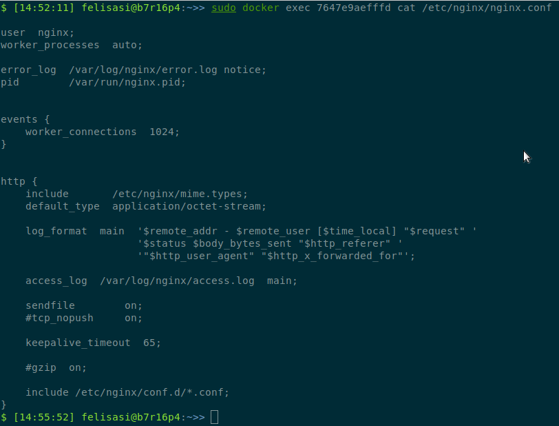

*Рисунок 2.1 - Выполнение команды `sudo docker exec 7647e9aefffd cat /etc/nginx/nginx.conf`*

### 2.2 Создать на локальной машине файл nginx.conf. Настроить в нем по пути /status отдачу страницы статуса сервера nginx

В папке проекта создан файл nginx.conf с помощью команды `touch nginx.conf`. Затем открыт файл nginx.conf в программе VS Code, вставлено содержимое файла из первого пункта задания (см. рисунок 2.1), добавлен к коду следующий кусок кода:

```nginx
server {
    listen 80;
    server_name localhost;

    location /status {
        stub_status on;
        access_log off;
        allow 127.0.0.1;  # Разрешить доступ только с localhost
    }
}
```
После этого закомментируем строку:

```nginx
include /etc/nginx/conf.d/*.conf;
```
Подробнее о каждой строке:

* __listen 80:__ Эта строка указывает серверу слушать на порту 80, что является стандартным HTTP-портом для негарантированных соединений.
* __server_name localhost:__ Это задает имя сервера (доменное имя), для которого будут применяться настройки внутри этого блока. В данном случае, сервер будет отвечать на запросы, адресованные на localhost.
* __stub_status on:__ Эта директива включает отдачу страницы статуса сервера. Страница статуса предоставляет информацию о текущей нагрузке, количестве активных соединений и другой статистике сервера.
* __access_log off:__ Эта директива отключает логирование доступа для этого пути. Таким образом, запросы к /status не будут логироваться.
* __allow 127.0.0.1:__ Эта директива указывает, каким IP-адресам разрешен доступ к данному пути. В данном случае, доступ разрешен только с IP-адреса 127.0.0.1 (localhost), что обеспечивает безопасность этой страницы статуса.

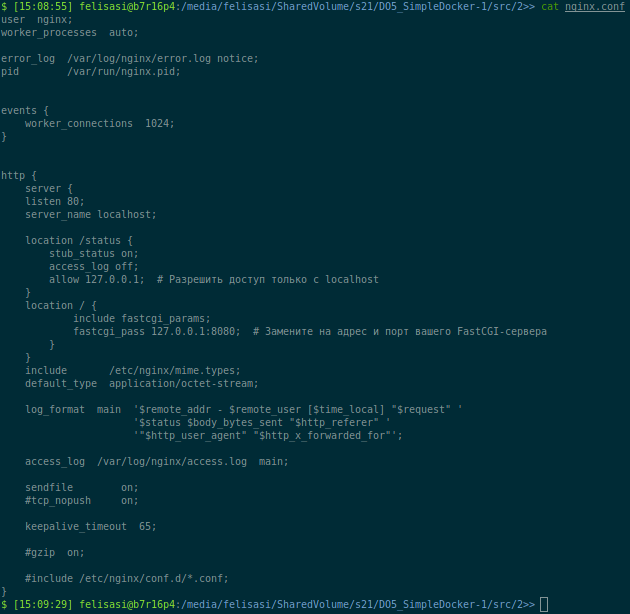

*Рисунок 2.2 - Выполнение команды `cat nginx.conf`*

### 2.3 Скопировать созданный файл nginx.conf внутрь докер образа через команду `docker cp`

Выполняю команду `sudo docker ps`, чтобы узнать id контейнера. Далее выполняю копирование файла nginx.conf из текущей папки внутрь докер-образа с помощью команды `sudo docker cp nginx.conf 7647e9aefffd:/etc/nginx/nginx.conf`

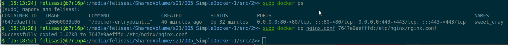

*Рисунок 2.3 - Выполнение команд `sudo docker ps` и `sudo docker cp nginx.conf 7647e9aefffd:/etc/nginx/nginx.conf`*


### 2.4 Перезапустить nginx внутри докер образа через команду `exec`

Перезапускаю nginx с помощью команды `sudo docker exec 7647e9aefffd nginx -s reload`

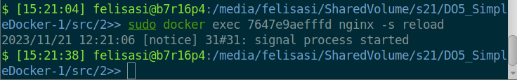

*Рисунок 2.4 - Выполнение команды `sudo docker exec 7647e9aefffd nginx -s reload`*

### 2.5 Проверить, что по адресу localhost:80/status отдается страничка со статусом сервера nginx

Проверяю, что после выполнения команды `curl localhost:80/status` отдается страничка со статусом сервера nginx

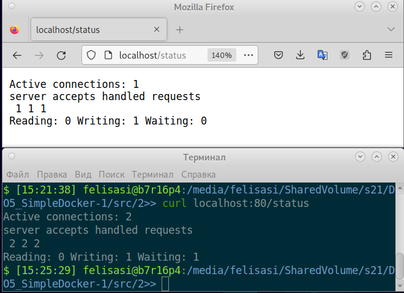

*Рисунок 2.5 - Выполнение команды `curl localhost:80/status`*

### 2.6 Экспортировать контейнер в файл container.tar через команду `export`

Выполняю команду `sudo docker export 7647e9aefffd > container.tar` и проверяю, что файл появился в текущей директории с помощью команды `ll`

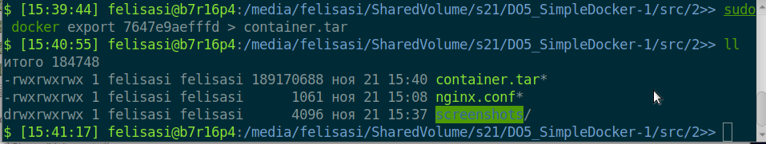

*Рисунок 2.6 - Выполнение команды `sudo docker export 7647e9aefffd > container.tar` и `ll`*

### 2.7 Остановить контейнер

Выполняю остановку контейнера командой `sudo docker stop 7647e9aefffd`

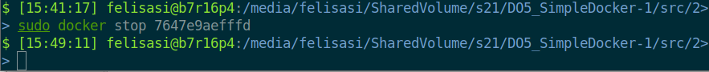

*Рисунок 2.7 - Выполнение команды `sudo docker stop 7647e9aefffd`*

### 2.8 Удалить образ через `docker rmi [image_id|repository]`, не удаляя перед этим контейнеры

Удаляю образ командой `sudo docker rmi -f c20060033e06`

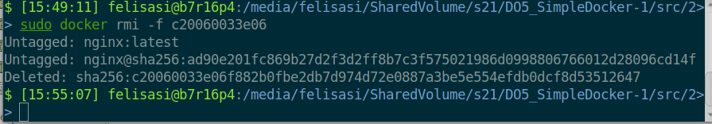

*Рисунок 2.8 - Выполнение команды `sudo docker rmi -f c20060033e06`*

### 2.9 Удалить остановленный контейнер

Удаляю остановленный контейнер командой `sudo docker rm 7647e9aefffd` и потом проверяю командой `sudo docker ps -a`, что контейнер удалился.

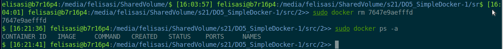

*Рисунок 2.9 - Выполнение команд `sudo docker rm 7647e9aefffd` и `sudo docker ps -a`*

### 2.10 Импортировать контейнер обратно через команду `import`

Выполняю импорт командой `sudo docker import container.tar nginx:latest`, где ___nginx___ - это имя образа (REPOSITORY), а ___latest___ - это тэг образа (TAG).

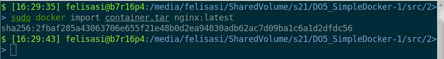

*Рисунок 2.10 - Выполнение команды `sudo docker import container.tar nginx:latest`*

### 2.11 Запустить импортированный контейнер

Выполняю команду\
`sudo docker run -d -p 80:80 nginx:latest nginx -g "daemon off;"`\
где ___nginx:latest___ - это имя и тег образа, а ___nginx -g "daemon off;"___ - это команда, которая будет выполняться внутри контейнера. Она используется для запуска nginx и удерживания контейнера в фоновом режиме.
Затем командой `sudo docker ps` проверяю, что контейнер успешно запущен

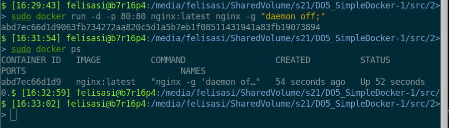

*Рисунок 2.11 - Выполнение команд `sudo docker run -d -p 80:80 nginx:latest nginx -g "daemon off;"` и `sudo docker ps`*


### 2.12 Проверить, что по адресу localhost:80/status отдается страничка со статусом сервера nginx

Проверяю командой `curl localhost:80/status`, что отдается страничка со статусом сервера nginx

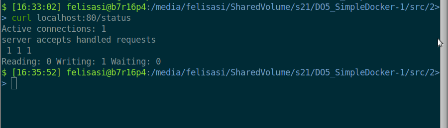

*Рисунок 2.12 - Выполнение команды `curl localhost:80/status`*

***
## Part 3. Мини веб-сервер

### 3.1 Написать мини сервер на C и FastCgi, который будет возвращать простейшую страничку с надписью Hello World!

* Сначала очистим докер от ненужных образов. Для этого нужно использовать команду `sudo docker system prune`
  
>__Примечание:__\
При выполнении команды `sudo docker system prune` не могут быть удалены запущенные образы. Посмотрите какие у вас есть в наличии (`sudo docker ps -a`) и остановите все запущенные командами:\
`docker stop <container_id_1> <container_id_2> .. <container_id_N>`.

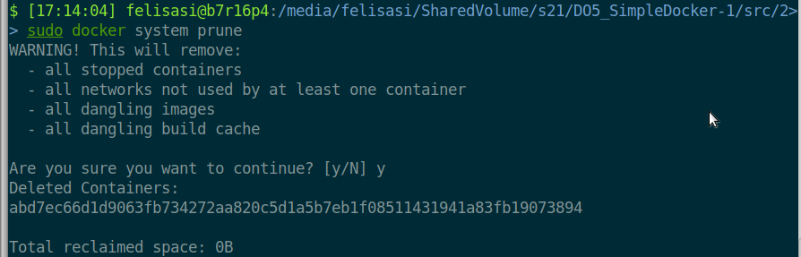

*Рисунок 3.1 - Выполнение команды `sudo docker system prune`*

* Создадим файл __mini_server.c__ и напишем свой мини-сервер
```c
#include <stdio.h>
#include <fcgiapp.h> /* FastCGI application server programs */
#include "fcgi_stdio.h" /* там функция FCGI_Accept */

int main(/*int argc, char* argv*/ void) { /* не требуем и не считываем входные параметры */
  
  while (FCGI_Accept() >= 0) {
    /* Функция FCGI_Accept блокируется до тех пор, пока не поступит новый запрос на выполнение программы. */
    printf("Content-Type: text/html\n\n");
    /* отправляем заголовок Content-type и сообщаем что тип документа text/html */
    printf("Hello World!\n");
  }

  return 0;
}
```

* Запустим написанный мини-сервер через __spawn-fcgi__ на порту 8080. Для этого загрузим docker командой `sudo docker pull nginx`. Далее запустим образ с портом 81

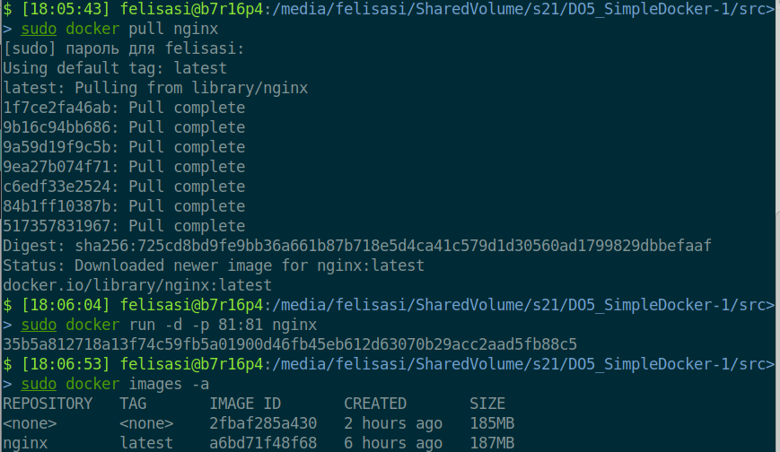

*Рисунок 3.2 - Выполнение команд `sudo docker pull nginx`, `sudo docker run -d -p 81:81 nginx` и `sudo docker images -a`*

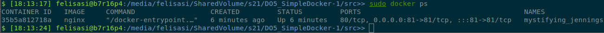

*Рисунок 3.2 - Выполнение команды `sudo docker ps`*

* Обновим контейнер перед загрузкой библиотек и установим нужные библиотеки с помощью команд `sudo docker exec mystifying_jennings apt update` и `sudo docker exec mystifying_jennings apt install -y gcc spawn-fcgi libfcgi-dev`. После этого сделаем коммит изменений

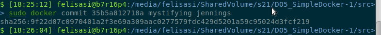

*Рисунок 3.4 - Выполнение команды `sudo docker commit 35b5a812718a mystifying_jennings`*

### 3.2 Запустить написанный мини сервер через spawn-fcgi на порту 8080

* Загрузим в контейнер файлы __nginx.conf__ (из [Части 2](#part-2-операции-с-контейнером)) и __mini_server.c__ с помощью команд\
  `sudo docker cp nginx.conf mystifying_jennings:/etc/nginx/`\
  `sudo docker cp mini_server.c mystifying_jennings:/mini_server.c`\
  Затем скомпилируем сервер командой\
  `sudo docker exec mystifying_jennings gcc ./mini_server.c -lfcgi -o mini_server`\
  Теперь запустим мини-сервер через spawn-fcgi на порту 8080 командой\
  `sudo docker exec mystifying_jennings spawn-fcgi -p 8080 mini_server`

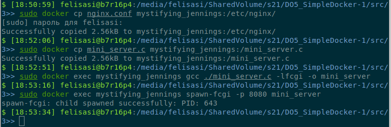

*Рисунок 3.5 - Выполнение команд для запуска мини-сервера. Строка __spawn-fcgi: child spawned successfulle: PID: 643 означает__, что процесс порожден с PID 643. Это указывает на успешное создание дочернего процесса с использованием __spawn-fcgi__*

* Перезапустим контейнер с изменениями командой `sudo docker exec mystifying_jennings nginx -s reload`

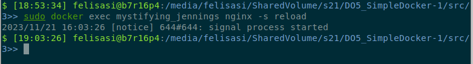

*Рисунок 3.6 - Выполнение команды `sudo docker exec mystifying_jennings nginx -s reload`*

### 3.3 Написать свой nginx.conf, который будет проксировать все запросы с 81 порта на 127.0.0.1:8080

Содержимое файла `nginx.conf`:
```nginx
user  nginx;
worker_processes  auto;

error_log  /var/log/nginx/error.log notice;
pid        /var/run/nginx.pid;


events {
    worker_connections  1024;
}


http {
    include       /etc/nginx/mime.types;
    default_type  application/octet-stream;

    log_format  main  '$remote_addr - $remote_user [$time_local] "$request" '
                      '$status $body_bytes_sent "$http_referer" '
                      '"$http_user_agent" "$http_x_forwarded_for"';

    access_log  /var/log/nginx/access.log  main;

    sendfile        on;
    #tcp_nopush     on;

    keepalive_timeout  65;

    #gzip  on;

    # include /etc/nginx/conf.d/*.conf;

    server {
        listen 81;
        server_name localhost;

        location / {
            include fastcgi_params;
            fastcgi_pass 127.0.0.1:8080;
        }
        
        location = /status {
            stub_status;
        }
    }
}
```

### 3.4 Проверить, что в браузере по localhost:81 отдается написанная вами страничка

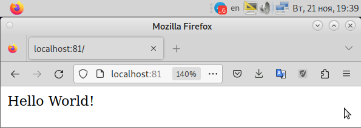

*Рисунок 3.7 - Вывод в браузере __Hello world!__*

### 3.5 Положить файл nginx.conf по пути ./nginx/nginx.conf (это понадобится позже)

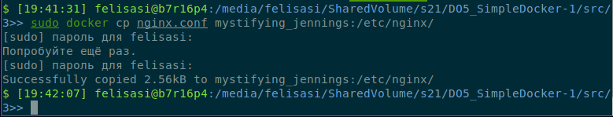

*Рисунок 3.8 - Выполнение команды `sudo docker cp nginx.conf mystifying_jennings:/etc/nginx/`*

***
## Part 4. Свой докер

### 4.1 Написать свой докер образ, который:

* собирает исходники мини сервера на FastCgi из [Части 3](#part-3-мини-веб-сервер)
* запускает его на порту 8080
* копирует внутрь образа написанный ./nginx/nginx.conf
* запускает nginx.

Создадим Dockerfile и напишем следующие команды:

```Dockerfile
FROM nginx

COPY ./mini_server.c /mini_server.c
COPY ./nginx.conf /etc/nginx/nginx.conf
COPY ./run.sh /run.sh

RUN \
    apt-get update && \
    apt install -y gcc libfcgi-dev spawn-fcgi && \
    apt clean && rm -rf /var/lib/apt/lists/*; \
    chmod +x ./run.sh
    
ENTRYPOINT ["bash", "./run.sh"]
```

Создадим файл nginx.conf с содержимым из [Части 3](#part-3-мини-веб-сервер)

Для удобства выполнения дальнейших нам понадобятся следующие скрипты:\
run_dockerfile.sh:

```sh
#!/bin/bash

sudo docker build . -t myserver:felisasi
sudo docker images
sudo docker run -d -p 80:81 --rm --name server myserver:felisasi
sudo docker ps -a
curl localhost:80
curl localhost:80/status
sudo docker stop server
```

run.sh:
```sh
#!/bin/bash

gcc ./mini_server.c -lpthread -lfcgi -o mini_server 
spawn-fcgi -p 8080 ./mini_server
nginx -g 'daemon off;'
nginx -s reload
```

Запускаю я скрипт __run_dockerfile.sh__, а скрипт __run.sh__ запускается уже в докере.

> __Примечание:__\
>  Перед запуском нужно убедиться, что порт 80 не занят.\
> Необходимо проверить, занимают ли контейнеры данный порт командой\
> `sudo docker ps`\
> Если да, то нужно контейнеры остановить командой `sudo docker stop <container_id>`\
> Так же необходимо проверить, что служба __nginx__ отключена (данная служба обычно занимает порт 80)\
> Проверить активность службы можно командой
>`sudo service nginx status`\
> а отключить: `sudo service nginx stop`

### 4.2 Собрать написанный докер образ через docker build при этом указав имя и тег

`sudo docker build . -t myserver:felisasi`

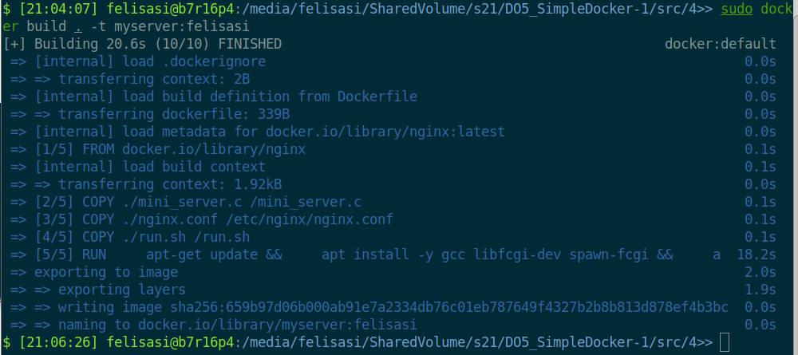

*Рисунок 4.1 - Вывод команды `sudo docker build . -t myserver:felisasi`*

### 4.3 Проверить через docker images, что все собралось корректно

`sudo docker images`

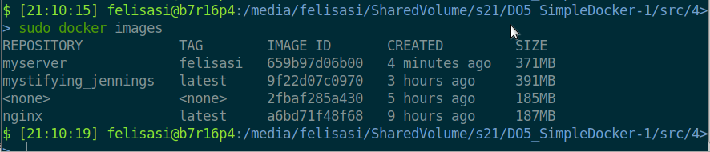

*Рисунок 4.2 - Вывод команды `sudo docker images`*

### 4.4 Запустить собранный докер образ с маппингом 81 порта на 80 на локальной машине и маппингом папки ./nginx внутрь контейнера по адресу, где лежат конфигурационные файлы nginx'а [(см. Часть 2)](#part-2-операции-с-контейнером)

`sudo docker run -d -p 80:81 --rm --name server myserver:felisasi`

> __Примечание:__\
>  Если возникает ошибка такого вида:\
>  `docker: Error response ...  ... Error starting userland proxy: listen tcp4 0.0.0.0:80: bind: address already in use.`\
> тогда командой ниже получите список процессов, которые занимают этот адрес(порт):\
> `netstat -tulpn | grep :80`\
> Среди них может оказаться *apache2* (иногда его нет в списке). Может помочь его остановка комндой:\
> `sudo systemctl stop apache2`

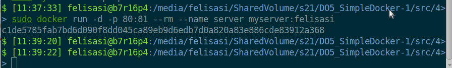

*Рисунок 4.3 - Вывод команды `sudo docker run -d -p 80:81 --rm --name server myserver:felisasi`*

### 4.5 Проверить, что по localhost:80 доступна страничка написанного мини сервера

`curl localhost:80`

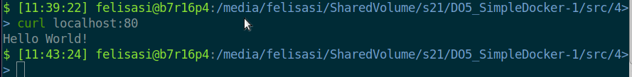

*Рисунок 4.4 - Вывод команды `curl localhost:80`*


### 4.6 Дописать в ./nginx/nginx.conf проксирование странички /status, по которой надо отдавать статус сервера nginx

### 4.7 Перезапустить докер образ

Если всё сделано верно, то, после сохранения файла и перезапуска контейнера, конфигурационный файл внутри докер образа должен обновиться самостоятельно без лишних действий.

### 4.8 Проверить, что теперь по localhost:80/status отдается страничка со статусом nginx

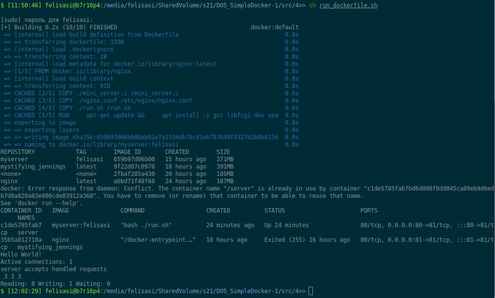

*Рисунок 4.5 - Запуск вышеперечисленных команд*

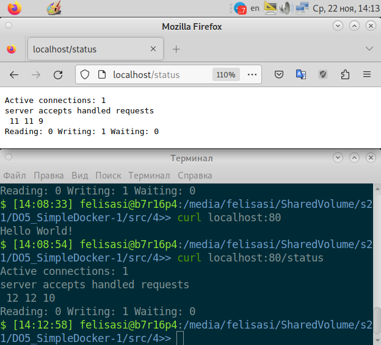

*Рисунок 4.6 - Вывод в браузере __localhost:80/status__ и в терминале*

***
## Part 5. Dockle

> __Dockle__ - это инструмент для статического анализа безопасности контейнеров Docker. Он предназначен для сканирования Docker-образов и контейнеров на наличие практик безопасности, нарушений стандартов и потенциальных уязвимостей. Dockle помогает выявить потенциальные проблемы ещё на этапе разработки и сборки образов, что позволяет обеспечить безопасность вашего приложения ещё до запуска контейнера.

Перед тем, как приступить к выполнению задания, необходимо установить Dockle. Ниже приведены шаги, которые я сделал для этого.

* В первую очередь я скачал Go версии 1.21 для Linux, он нужен для установки Dockle [по ссылке](https://go.dev/dl/).
* Через терминал я зашел в директорию, куда скачался архив, распаковал его командой `sudo tar -C /usr/local -xzf go1.21.0.linux-amd64.tar.gz ` в директорию __/usr/local__
* Затем командой `sudo vim ~/.profile` добавил следующие строки в конец файла:
  ```
  export PATH=$PATH:/usr/local/go/bin
  export GOPATH=$HOME/go
  export GOBIN=$GOPATH/bin
  ```
  Это нужно для того, чтобы команда `go` работала в терминале. После этого я выполнил команду `source ~/.profile`, чтобы изменения применились.

* Необходимо перезапустить терминал и затем выполнить команду `go version`. Терминал выведет версию установленного Go
* Далее нужно установить __goreleaser__ командой `sudo apt install -y goreleaser`
* Cоздаем папку командой `mkdir -p ~/temp/dockle` и переходим в нее командой `cd ~/temp/dockle`
* Клонируем Dockle командой `git clone https://github.com/goodwithtech/dockle.git .`
* Выполняем сначала команду `go mod tidy`, а затем `goreleaser build --skip-validate`
* После завершения установки нужно зайти в папку __dist__. Там будут папки с файлом dockle для разных архитектур. Я выбрал __dockle_linux_amd64_v1__, зашел в эту папку, переместил файл командой `sudo mv dockle /usr/local/bin/`
> ___Примечание:___ На моей рабочей машине, где установлен Debian установка не была успешной и в папке _dist_ нужных папки не появились. Мне пришлось Часть 5 и 6 выполнить на ноутбуке где установлена Ubuntu. Поэтому скриншоты терминала будут другого цвета. 
* После этого проверил версию Dockle командой `dockle -v`

### 5.1 Просканировать образ из предыдущего задания через dockle [image_id|repository]

___Примечание:__ При выполнении команды `dockle [image_id|repository]` могут возникнуть проблемы с доступом к образам. Чтобы избежать этого, необходимо добавлять __sudo__ перед __dockle.___

* Возьмём все 4 файла из прежнего задания из папки src/4 и поместим в папку src/5. Для отличия от прежнего задания заменим имя образа и контейнера в скрипте.
Таким образом получим *run_dockerfile.sh*:

```sh
#!/bin/bash

sudo docker build . -t myserver5:felisasi5
sudo docker images
sudo docker run -d -p 80:81 --rm --name server myserver5:felisasi5
# sudo docker ps -a
# curl localhost:80
# curl localhost:80/status
sudo docker stop server
```

* Запустим скрипт `run_dockerfiles.sh` и после этого выполним команду `sudo dockle [image_id|repository]`

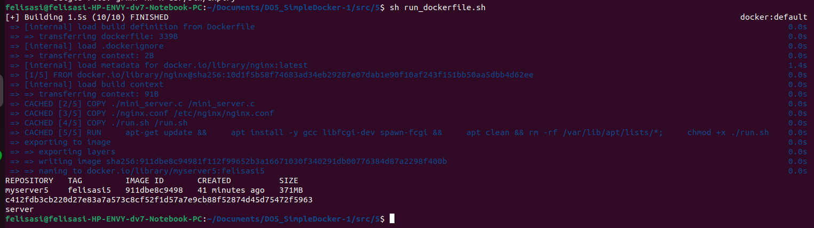

*Рисунок 5.1 - Выполнение команды `run_dockerfiles.sh`*

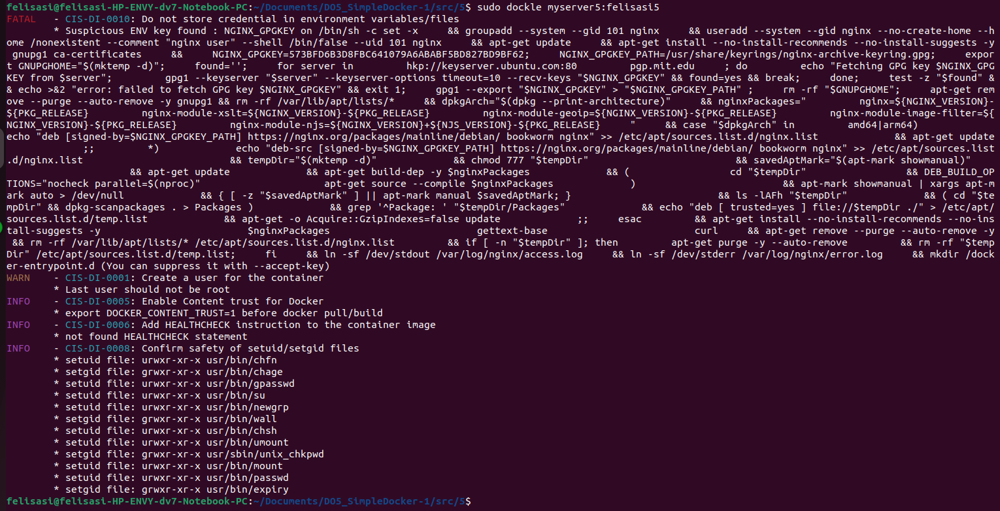

*Рисунок 5.2 - Выполнение команды `sudo dockle myserver5:felisasi5`*

### 5.2 Исправить образ так, чтобы при проверке через dockle не было ошибок и предупреждений (FATAL и WARM)

> В контексте вывода инструмента dockle, ошибки и предупреждения относятся к выявленным проблемам в безопасности Docker-образов. Вот разъяснение различий между ошибками и предупреждениями:
> * Ошибки (FATAL): Ошибки указывают на реальные и серьезные нарушения безопасности в Docker-образе. Эти нарушения требуют обязательного вмешательства, чтобы устранить риски. Примеры ошибок в выводе dockle могут включать:
>   * Важные конфиденциальные данные, такие как пароли или ключи, хранятся внутри образа.
>   * Отсутствие необходимых настроек безопасности.
>   * Использование устаревших или уязвимых компонентов.
> * Предупреждения (WARN): Предупреждения указывают на потенциальные проблемы в безопасности, которые не являются критическими, но могут потребовать дополнительного внимания и оценки. Они предоставляют информацию о возможных рисках. Примеры предупреждений в выводе dockle могут включать:
>   * Использование образа с тегом "latest", что может вызвать проблемы при обновлении.
>   * Отсутствие рекомендуемых настроек безопасности, но без прямого угрозы.
>* Информационные сообщения (INFO): Информационные сообщения предоставляют дополнительную информацию о выполняемых проверках, рекомендациях и контексте безопасности. Они не являются ошибками или предупреждениями, и их цель — повысить осведомленность пользователя о настройках безопасности. Примеры информационных сообщений в выводе dockle могут включать:
>   * Рекомендации по настройке безопасности.
>   * Информация о поддерживаемых стандартах безопасности (например, CIS Docker Benchmark).

#### Добавим в *run_dockerfile.sh*:
*  `export DOCKER_CONTENT_TRUST=1` - перед build, чтобы избежать сообщение __INFO "CIS-DI-0005: Enable Content trust for Docker"__

* `sudo dockle -ak NGINX_GPGKEY -ak NGINX_GPGKEY_PATH myserver5:felisasi5` - запустить проверку dockle с флагами, которые снимают ошибку __FATAL "CIS-DI-0010: Do not store credential in environment variables/files"__
Окончательный вид *run_dockerfile.sh*:

```sh
  #!/bin/bash

export DOCKER_CONTENT_TRUST=1
sudo docker build . -t myserver5:felisasi5
sudo docker images
sudo dockle -ak NGINX_GPGKEY -ak NGINX_GPGKEY_PATH myserver5:felisasi5
export DOCKER_CONTENT_TRUST=0
  ```
#### Добавим в *Dockerfile*:
* пользователя для контейнера в Dockerfile, чтобы исключить предпреждение __WARN "CIS-DI-0001: Create a user for the container"__
* инструкцию __HEALTHCHECK__ в Dockerfile, которая поможет избежать сообщение __INFO CIS-DI-0006: Add HEALTHCHECK instruction to the container image__. Инструкция __HEALTHCHECK__ в Dockerfile используется для определения того, как приложение или сервис внутри контейнера должно быть проверено на наличие работающего состояния. Это позволяет Docker-демону мониторить состояние контейнера и автоматически перезапускать его в случае, если приложение перестало отвечать на запросы или работать корректно.
Окончательно содержимое файла __Dockerfile__:
```sh
FROM nginx

RUN useradd -m user1

COPY ./mini_server.c /mini_server.c
COPY ./nginx.conf /etc/nginx/nginx.conf
COPY ./run.sh /run.sh

RUN \
    apt-get update && \
    apt install -y gcc libfcgi-dev spawn-fcgi && \
     apt clean && rm -rf /var/lib/apt/lists/*; \
    chmod +x ./run.sh

USER user1

HEALTHCHECK --interval=5m --timeout=3s \
  CMD curl -f http://localhost/ || exit 1
    
ENTRYPOINT ["bash", "./run.sh"]
```

После того как скрипты __run_dockerfile.sh__ и __run.sh__ готовы, запускаем скрипт __run_dockerfile.sh__

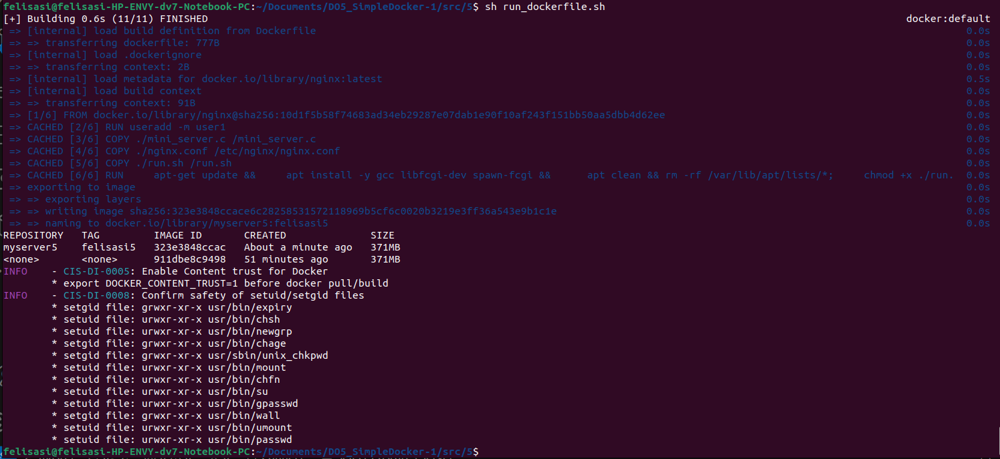

*Рисунок 5.3 - Вывод терминала после выполнения скрипта. Как мы видим, ошибок и предупреждений теперь нет.*

***
## Part 6. Базовый Docker Compose

### 6.1 Написать файл docker-compose.yml, с помощью которого:
* Пропишем поднятие докер контейнера из [Части 5](#part-5-dockle) (он должен работать в локальной сети, т.е. не нужно использовать инструкцию EXPOSE и мапить порты на локальную машину)
* Пропишем поднятие докер контейнера с nginx, который будет проксировать все запросы с 8080 порта на 81 порт первого контейнера
  Содержимое файла *__docker-compose.yml__*
```Makefile

version: "2.4"

services:
  
  part05:
    image: server:part05
    build: 
      context: ./05
      dockerfile: Dockerfile
    container_name: server05

  part06:
    image: nginx
    build:
      context: ./06
      dockerfile: Dockerfile
    ports:
      - "80:8080"
    container_name: server06

```

### 6.2 Замапить 8080 порт второго контейнера на 80 порт локальной машины

Смотри предпоследние строки файла *__docker-compose.yml__*
```Makefile
    ports:
      - "80:8080"
```

### 6.3 Остановить все запущенные контейнеры

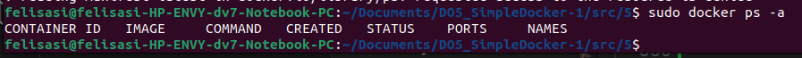

*Рисунок 6.1 - Вывод терминала после выполнения команды `sudo docker ps -a`*

### 6.4 Собрать и запустить проект с помощью команд `docker-compose build` и `docker-compose up`

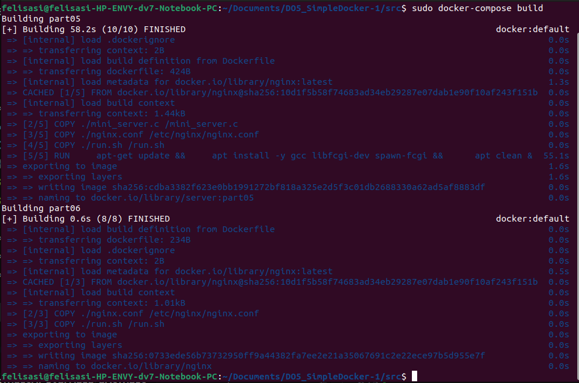

*Рисунок 6.2 - Вывод терминала после выполнения команды `sudo docker-compose build`*

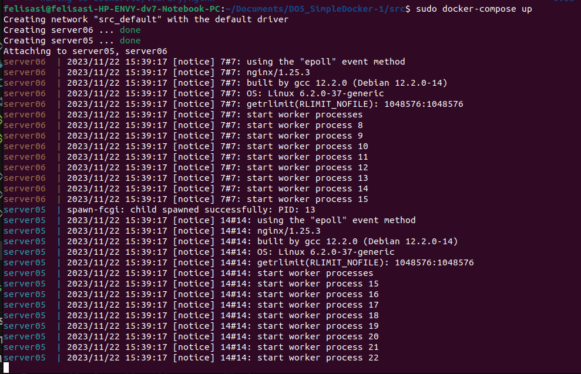

*Рисунок 6.3 - Вывод терминала после выполнения команды `sudo docker-compose up`*

### 6.5 Проверить, что в браузере по localhost:80 отдается написанная вами страничка, как и ранее


*Рисунок 6.4 - Вывод __Hello World!__ в браузере*


*Рисунок 6.5 - Вывод в терминале при выполнении запроса в браузере*


*Рисунок 6.5 - Остановка docker и прекращение выдачи запроса в браузере*

***
